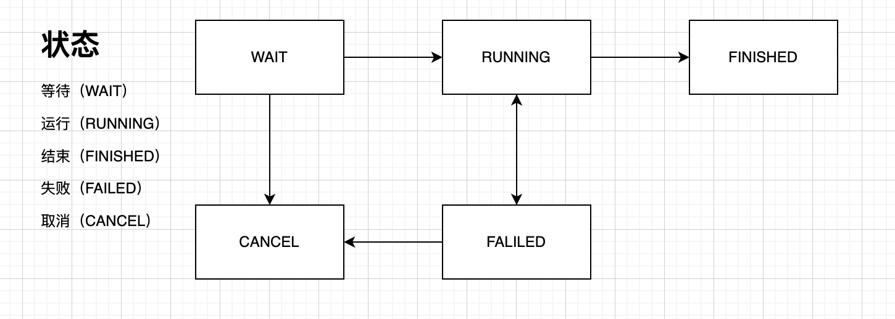

# Task-Retry

任务重试工具 - 一个基于 Spring Boot 的分布式任务重试框架

## 简介

Task-Retry 是一个轻量级的任务重试工具，提供自动重试、任务调度、状态管理等功能。支持 MySQL 和 PostgreSQL 数据库，可集成 SnailJob 或 Spring Schedule 进行任务调度。

## 特性

- ✅ 自动重试机制，支持自定义最大重试次数
- ✅ 任务状态管理（WAIT、RUNNING、FINISHED、FAILED、CANCEL）
- ✅ 支持 MySQL 和 PostgreSQL 数据库
- ✅ 可集成 SnailJob 分布式任务调度
- ✅ 支持 Spring Schedule 定时任务
- ✅ 任务优先级排序
- ✅ 异步/同步执行支持
- ✅ MDC 日志追踪支持
- ✅ 乐观锁并发控制

## 快速开始

### 1. 添加依赖

```xml
<dependency>
    <groupId>miracle.github.taskretry</groupId>
    <artifactId>task-retry-spring-boot-starter</artifactId>
    <version>1.0.5-SNAPSHOT</version>
</dependency>
```

### 2. 数据库初始化

执行对应的 SQL 脚本创建任务表：

**MySQL:**
```sql
-- 执行 db/mysql.sql
```

**PostgreSQL:**
```sql
-- 执行 db/postgre.sql
```

### 3. 配置应用

在 `application.yml` 或 `application.properties` 中添加配置：

```yaml
task-retry:
  # 分发任务的颗粒度（分页大小），默认 100
  particle-size: 100
  # 任务最大重试次数，默认 3 次
  max-retry-count: 3
  # 启动任务自动分发类型：SCHEDULE 或 SNAIL_JOB
  auto-job: SCHEDULE
  # 定时任务 Cron 表达式，默认每 10 秒执行一次
  cron: "0/10 * * * * ?"
```

### 4. 使用示例

#### 注册任务

```java
@Autowired
private TaskOperator taskOperator;

// 方式一：完整参数
taskOperator.register("ORDER_PAY", "order_123", 
    LocalDateTime.now().plusMinutes(5), 
    "{\"orderId\":\"123\",\"amount\":100}");

// 方式二：简化参数（立即执行）
taskOperator.register("ORDER_PAY", "order_123", 
    "{\"orderId\":\"123\",\"amount\":100}");

// 方式三：仅业务类型
taskOperator.register("ORDER_PAY", 
    "{\"orderId\":\"123\"}");
```

#### 查询任务

```java
@Autowired
private TaskQuery taskQuery;

// 按业务类型和业务 ID 查询
List<Task> tasks = taskQuery.queryByBusiness("ORDER_PAY", "order_123");

// 按业务类型查询
List<Task> tasks = taskQuery.queryByBusiness("ORDER_PAY");

// 按 ID 查询
Task task = taskQuery.getById(1L);

// 批量查询
List<Task> tasks = taskQuery.queryByIds(Arrays.asList(1L, 2L, 3L));

// 查询是否还有未完成的任务
Boolean hasNotComplete = taskQuery.hasNotComplete("ORDER_PAY", "group_1");

// 查询是否已经完全失败
Boolean hasFail = taskQuery.hasFail("ORDER_PAY", "group_1");

// 查询正在处理的任务数量
Integer count = taskQuery.processingCount("ORDER_PAY");
```

#### 取消任务

```java
// 取消指定 ID 的任务
taskOperator.cancel(Arrays.asList(1L, 2L, 3L));
```

#### 重置任务

```java
// 重置任务状态回 WAIT，并重置已执行次数为 0
taskOperator.reset(Arrays.asList(1L, 2L, 3L));
```

## 任务状态说明

| 状态 | 说明 |
|------|------|
| WAIT | 等待执行 |
| RUNNING | 正在执行 |
| FINISHED | 已完成 |
| FAILED | 已失败（达到最大重试次数） |
| CANCEL | 已取消 |

## 状态机流转



## 配置项说明

| 配置项 | 说明 | 默认值 |
|--------|------|--------|
| `task-retry.particle-size` | 任务分发颗粒度（分页大小） | 100 |
| `task-retry.max-retry-count` | 任务最大重试次数 | 3 |
| `task-retry.auto-job` | 自动任务调度类型：`SCHEDULE` 或 `SNAIL_JOB` | SCHEDULE |
| `task-retry.cron` | Spring Schedule 的 Cron 表达式 | 0/10 * * * * ? |

## 技术栈

- Java 17+
- Spring Boot 3.2.5
- MyBatis
- MySQL / PostgreSQL
- Guava
- Lombok
- SnailJob (可选)

## 项目结构

```
task-retry
├── db/                      # 数据库脚本
│   ├── mysql.sql           # MySQL 建表脚本
│   └── postgre.sql         # PostgreSQL 建表脚本
├── src/main/java/com/task/retry/
│   ├── autoconfig/         # 自动配置
│   ├── domain/             # 领域层
│   ├── entity/             # 实体类
│   ├── enums/              # 枚举类
│   ├── exception/          # 异常类
│   ├── impl/               # 接口实现
│   ├── job/                # 任务调度
│   ├── mapper/             # MyBatis Mapper
│   ├── TaskOperator.java   # 任务操作接口
│   └── TaskQuery.java      # 任务查询接口
└── pom.xml
```

## License

本项目采用 MIT 许可证

## 作者

miracle

## 更新日志

### v1.0.5-SNAPSHOT
- 支持 MySQL 和 PostgreSQL 双数据库
- 集成 SnailJob 分布式任务调度
- 优化任务状态管理
- 支持任务优先级排序
- 增加 MDC 日志追踪支持
